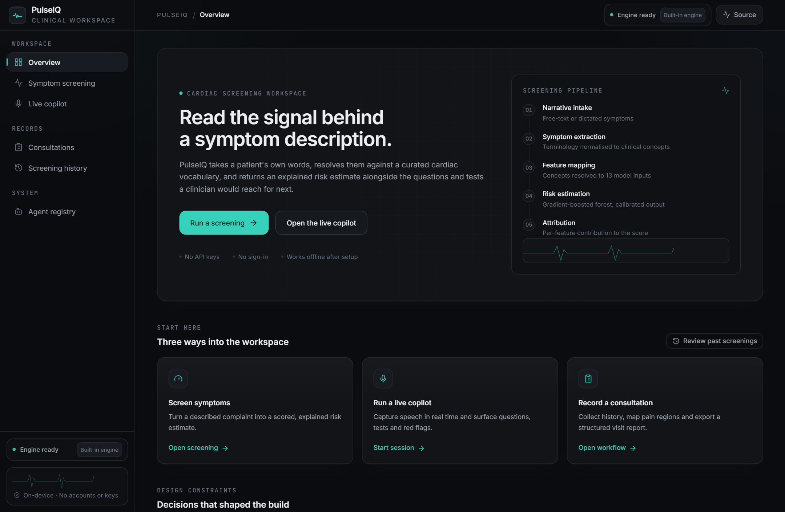
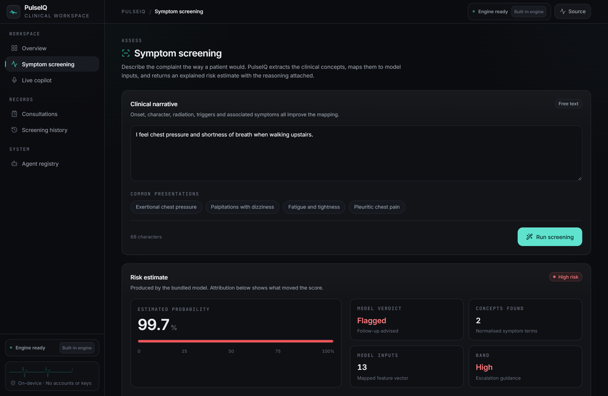
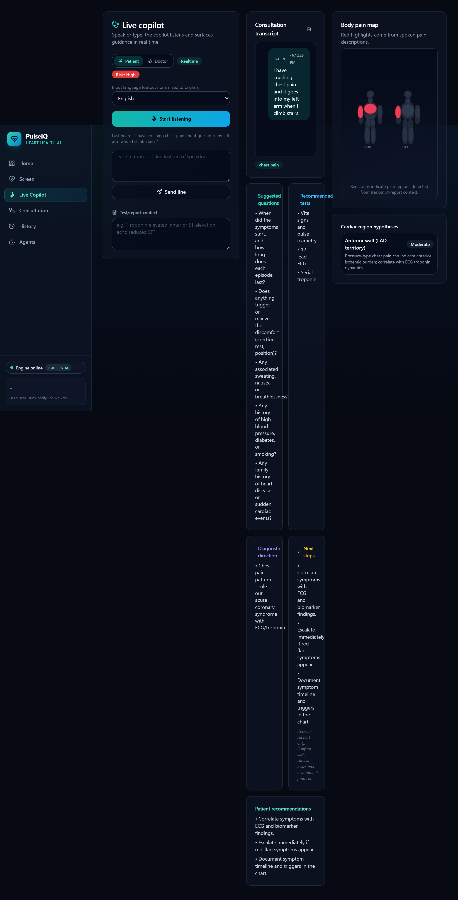
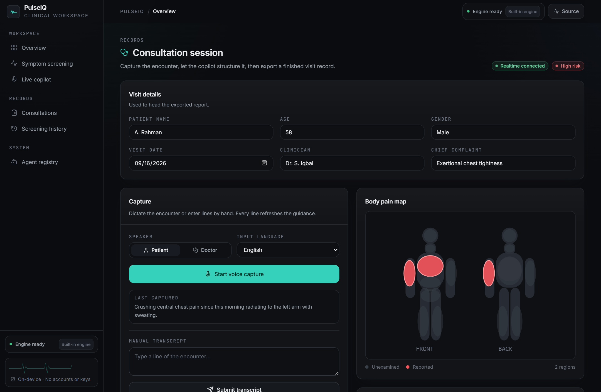
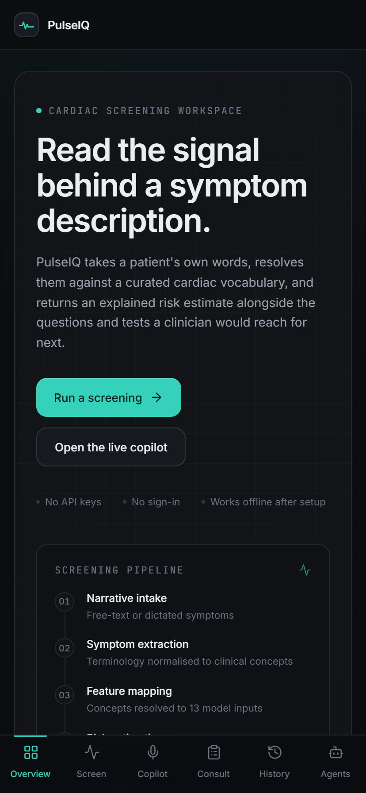

<div align="center">



# 🫀 PulseIQ

### Cardiac screening that explains itself.

**An open-source clinical workspace that turns a patient's own words into an explained
risk estimate — then carries the encounter through to a structured report.**

Runs locally. No cloud account, no API keys, no data leaves the device — the clinician account the first launch asks for is a row in a SQLite file on your own machine.

[](https://github.com/Aabyyss/PulseIQ-/actions/workflows/tests.yml)
[](https://github.com/Aabyyss/PulseIQ-/actions/workflows/deploy-pages.yml)
[](LICENSE)
[](https://www.python.org/)
[](https://fastapi.tiangolo.com/)
[](https://react.dev/)
[](https://www.typescriptlang.org/)

[**🌐 Live project page**](https://aabyyss.github.io/PulseIQ-/) · [**▶ Watch the walkthrough**](cardio-ai-system/docs/demo/pulseiq-walkthrough.mp4) · [**📸 Screenshots**](cardio-ai-system/docs/screenshots) · [**🤝 Contributing**](#-contributing)

</div>

---

## Why PulseIQ exists

Most medical-AI demos quietly depend on a paid LLM key — the demo works until you try it.
**PulseIQ was built to need nothing.** A built-in clinical language engine does all of the
language work offline. An optional free local model upgrades the experience automatically if
one is running. A hosted model is an option, never a prerequisite.

And instead of returning a bare score, every screen shows its reasoning: which concepts were
detected, which model inputs they produced, and what a clinician would reach for next.

## ✨ What it does

| | Feature | What it does |
|---|---|---|
| 🩺 | **Symptom screening** | Free-text narrative → clinical concepts → 13 model inputs → an explained probability, with every step visible |
| 🎙️ | **Live copilot** | Realtime speech-to-text with speaker attribution, suggested questions, recommended investigations and red-flag escalation — plus hands-free voice commands ("save visit") and a live mic level meter |
| 🧍 | **Body pain mapping** | Described pain plots onto a front/back diagram as the encounter runs |
| 📄 | **Consultation reports** | Structured visit capture → one-click PDF export of summary, advice, plan and red flags |
| 🌍 | **Multilingual capture** | 9 capture languages — English, Urdu (script + Roman), Hindi, Arabic, Korean, French, Spanish, German, Mandarin — normalised to English for analysis |
| 🖼️ | **Report reading** | Lab reports and scans parsed for key findings (needs a vision model) |
| 🕘 | **History & review** | Screenings, notes and consultations kept in the local database (newest 200), with band distribution and mean probability |
| 📱 | **App shell on every device** | Five destinations plus More on a phone, a labelled rail from 1024px, one list behind both — with safe-area insets, 320–2560px audited, and both palettes |
| ⌨️ | **Command palette** | Ctrl/⌘ K jumps to any workspace screen, ranked for the words clinicians actually type ("drugs", "records", "privacy") |
| 📲 | **Installable, offline shell** | A manifest (with long-press shortcuts) and service worker cache the shell and its hashed bundle; `/api` and `/ws` are never cached, and an offline bar says what is still possible |
| 🖨️ | **Print-ready handouts** | Patient timeline and visit records print on white paper without the app chrome — the stylesheet hides what is marked, not every header and button |
| 🤖 | **20 clinical agents** | Guidelines, uncertainty, causality, fairness, robustness, explainability — each an isolated, replaceable module |

<div align="center">

| | |
|:---:|:---:|
|  |  |
| *Explained screening result* | *Live consultation copilot* |
|  |  |
| *Consultation capture* | *Narrow viewport* |

</div>

## 🆓 The free-AI model (three tiers, none required)

| Tier | What it provides | Setup |
|---|---|---|
| **1 · Always on** | Built-in rule-based clinical engine — insights, copilot plans, reports, fully offline | **Nothing. It's the default.** |
| **2 · Optional** | [Ollama](https://ollama.com) local LLM — richer AI text, still free & local, auto-detected | `ollama pull llama3.2` |
| **3 · Optional** | Gemini free tier — used automatically if you already have a key | `GEMINI_API_KEY` env var |

## 🚀 Quickstart

**What you need:** a Windows, macOS or Linux machine — that's it. On Windows, `setup.ps1`
installs Python 3.12 and Node.js automatically (via winget) if they are missing. First launch
opens a sign-in screen: create your clinician account (it lives only on your machine), then
explore. Optional but recommended for richer AI text: install [Ollama](https://ollama.com) and
run `ollama pull llama3.2` — PulseIQ detects it and upgrades automatically.

**Windows** — or just double-click `Start-PulseIQ.cmd`:

```powershell
Set-ExecutionPolicy -Scope Process -ExecutionPolicy Bypass
.\setup.ps1          # one-time: virtualenv, dependencies, spaCy model
.\run-backend.ps1    # terminal 1
.\run-frontend.ps1   # terminal 2  →  http://localhost:5173
```

<details>
<summary><b>macOS / Linux</b></summary>

```bash
python -m venv .venv && source .venv/bin/activate
pip install -r requirements.txt
python -m spacy download en_core_web_sm

uvicorn backend.api_server:app --port 8000        # terminal 1

cd cardio-ai-system/frontend && npm install && npm run dev    # terminal 2
```
</details>

## 📲 Install it as an app

With the app open, use the browser's **Install** action (Chrome/Edge: the install icon in the
address bar; Safari on iOS: Share → *Add to Home Screen*). It launches standalone — no address
bar — and the shell it caches opens offline. Clinical responses are never cached by the service
worker: `/api` and `/ws` are excluded before any caching rule runs.

## 🧠 Model card

Random Forest over the **UCI Heart Disease (Cleveland)** dataset — 13 features, **297 patients**
(303 source records, 6 dropped for a missing `ca`/`thal`). The data is distributed under
[CC BY 4.0](https://creativecommons.org/licenses/by/4.0/); attribution, citation and every
modification are in [data/ATTRIBUTION.md](cardio-ai-system/data/ATTRIBUTION.md).

> **How the split is made.** `load_dataset()` removes exact duplicate rows *before* the split
> (this export has none — the guard stays because the previous file had 723), then the 297
> distinct feature vectors are split 80/20, stratified on the label, `random_state=42` —
> 237 train / 60 test. No profile can appear on both sides: training asserts it and
> `test_train_model.py` re-asserts it on every run.

| Metric | Holdout (60 rows) |
|---|---|
| Accuracy | 0.867 |
| Precision | 0.885 |
| Recall | 0.821 |
| F1 | 0.852 |
| ROC-AUC | 0.943 |
| Brier score | 0.129 |
| Calibration error (ECE) | 0.046 |
| 10-fold CV | 0.825 ± 0.069 accuracy · 0.906 ± 0.057 ROC-AUC |

> **Is the probability real?** ROC-AUC only says the ordering is right, and the app displays
> the number and bands it at 0.45 / 0.75 — so the value has to mean something. On out-of-fold
> predictions (one per distinct patient, n = 297) the Brier score is 0.129 against 0.25 for
> always saying 0.5, and ECE is 0.046 over ten bins. Mean predicted probability 0.462 vs an
> observed disease rate of 0.461. The full reliability table is in `heart_model_meta.json`, and
> `test_calibration.py` pins the arithmetic including an overconfident model that scores worse.

> **Why this card used to say 1.000.** The repository previously trained on the widely
> circulated Kaggle copy of the same cohort: 1,025 rows of which only 302 were distinct, with
> the target column inverted. Splitting before de-duplicating put identical patients in train
> and test, so recall and ROC-AUC both read 1.000. That copy was replaced with the UCI original
> (ADR-037) and the figure is withdrawn — the table above is what the model generalises to.

> **Label and code encoding.** `target = 1` when UCI `num > 0` (any angiographic disease).
> Categorical values follow the source codebook — `cp` 1–4, `thal` 3/6/7, `slope` 1–3 — and
> training asserts the polarity from feature means (disease carries a lower peak heart rate,
> deeper ST depression, more affected vessels). `test_feature_encoding.py` keeps the symptom
> mapper inside that codebook, because emitting values the dataset never contains is how a
> classic "crushing chest pain" presentation once scored Low.

> **Better data?** Provenance is now licensed and attributable, and the sample size is honest:
> 297 patients, not 1,025 rows. Same-schema sources exist (UCI multi-site and Statlog, both
> CC BY 4.0) but Statlog is these same patients and the other sites are small with missing
> `ca`/`thal`; genuinely different data is either a different prediction task (PTB-XL ECG) or
> access-controlled (MIMIC-IV, UK Biobank, Framingham). The licence review is in
> [docs/DATA_SOURCES.md](cardio-ai-system/docs/DATA_SOURCES.md).

## 🏗️ Architecture

```
frontend  React 18 · Vite · TypeScript · Tailwind
  ├── shell           one NAV list → phone bar + More sheet (< 1024px) · labelled rail (≥ 1024px)
  ├── /               overview (feed; aside from 1280px)
  ├── /consultation   live capture  WS /ws/consultation · POST /diagnose
  │                                POST /medication-review · POST /lab-report
  ├── /medications    narrative + record → POST /medication-review
  ├── /history        account-scoped screenings and saved consultations
  ├── /notes          private notes    /patients   per-patient timeline
  ├── /security       sessions, password, audit trail
  ├── /agents         GET /research-agents      /guidance   how to use it
  └── /login /privacy /terms /thank-you

backend  FastAPI (routes in api_server.py)
  ├── orchestrator.py       extraction → feature mapping → model → risk band
  ├── realtime_service.py   per-line fusion across the clinical agents
  ├── ai_assistant.py       three-tier reasoning, none of it required
  ├── auth_store.py         accounts, sessions, screenings, notes (SQLite)
  ├── risk_score_context.py record + wording → HEART · GRACE · CHA₂DS₂-VASc · ASCVD
  ├── lab_report.py         report text → reference-range flags (+ derived lipids)
  └── fhir_export.py        findings → a FHIR R4 Bundle, written to a file

agents/    20 rule-grounded clinical modules
models/    trained model + metadata
```

## 📁 Repository layout

```
cardio-ai-system/
├── backend/     FastAPI server, training script, pytest suite
├── agents/      20 rule-grounded clinical modules
├── frontend/    React application (vitest for the non-React logic)
├── models/      trained model and metadata (source, licence, metrics, calibration)
├── data/        dataset — UCI Cleveland, CC BY 4.0, with ATTRIBUTION.md and hashes
├── docs/        ADR, DESIGN (adaptive shell), FEATURES (roadmap), VERIFICATION (what the gate proves),
│               API spec, data flow, security, CI, compatibility, data sources (licences),
│               medication catalogue · screenshots · video
├── scripts/     E2E journey, UI audit (contrast/layout/states/PWA), source verifier, demo recording
└── setup.ps1 · run-*.ps1 · Start-PulseIQ.cmd
```

## 🧪 Quality gates

| Gate | Runs | What it proves |
|---|---|---|
| Backend pytest suite | CI · every push | 566 cases: clinical direction (symptom text → expected risk band), the published scores pinned row-by-row against their sources, the 36-option medication catalogue and its 53 interaction rules pinned to 12 citations, de-identification, the local stores, the login limiter, the FHIR bundle, the live medication screen, and the CI definition itself |
| Backend script checks | CI · every push | The older password-free runners, including the end-to-end pipeline walk (symptom text → mapped features → prediction) — nonzero exit fails the job |
| Frontend unit tests | CI · every push | `npm run test` (vitest + jsdom), 82 cases: extraction patterns, session and retry behaviour, page metadata, PDF pagination, theme and browser-chrome colour, navigation and palette ranking, and the service worker's caching policy |
| Frontend typecheck & build | CI · every push | `tsc -b` plus a production Vite build |
| UI contrast & layout audit | CI · every push | 22 opened states (account menu, consult tab, history tab, More sheet, command palette, theme switch) plus 12 routes × 4 widths × 2 palettes of WCAG AA contrast; 11 widths (320–2560px, both tablet orientations) of overflow/clipping/tap-target checks; WCAG 1.4.12 spacing overrides; 2.4.11 focus obscuring; manifest/icons/worker/offline shell — signed in, any violation fails the run |
| E2E journey | CI · every push | Playwright walks sign-in → adaptive navigation (rail, More sheet, Ctrl-K) → capture a line → save → PDF → thank-you → history against the **built bundle** served by `vite preview` and a live API, failing on any console error or failed API call |
| Catalogue sources | CI · every push | Every drug and rule cites a registered source and every source is cited; `make verify-sources NETWORK=1` additionally resolves the DOIs through Crossref |
| Lint | local | `npm run lint` — zero errors, zero warnings without a `--max-warnings` guard |

## 🤝 Contributing

Issues and pull requests are welcome. Good first areas: more symptom vocabulary, additional
capture languages, and extending the agent registry.

Before submitting, run the suites that CI runs:

```bash
cd cardio-ai-system && make install-dev && python -m pytest backend -q   # 566 cases
cd frontend && npm ci && npm run typecheck && npm run test && npm run lint && npm run build
```

`npm run e2e` and `npm run ui-audit` (both need the servers up) cover the full journey and the
UI gates; `make check` chains the tests, typecheck, lint and build.

CI runs six jobs on `ubuntu-24.04` and a `Gate` job that requires all of them
([docs/CI.md](cardio-ai-system/docs/CI.md)); require `Gate` in branch protection rather than
remembering six checks. One of those jobs rebuilds `data/heart.csv` from the licensed UCI source
and fails if the committed values, provenance record or attribution notice have drifted. [docs/VERIFICATION.md](cardio-ai-system/docs/VERIFICATION.md) states
what each check proves and what still needs a person (hosted CI, real devices, other browsers,
screen readers). The `ui-audit` job installs the runtime requirements, starts the API on
the port the built app forwards `/api` to, waits for `/health`, and then sweeps the app **signed
in** in both themes, failing if any route renders the sign-in page instead of itself, if a state
it opens never arrives, or if the workspace shell is missing. The `e2e` job builds the bundle,
serves it with `vite preview` and walks the save path against the real API. Both upload their
logs either way, so a red run can be diagnosed from its artifacts.

## ⚠️ Scope

PulseIQ is a **screening and documentation aid**. It does not diagnose, and its output must be
reviewed by a qualified clinician before informing care. Any presentation suggesting acute
coronary syndrome — ongoing chest pain, syncope or respiratory distress — must be escalated on
clinical grounds alone, regardless of what this software reports.

## 📄 License

MIT — see [LICENSE](LICENSE).

<div align="center">
<sub>Built as an open reference implementation of local-first clinical decision support.</sub>
</div>
